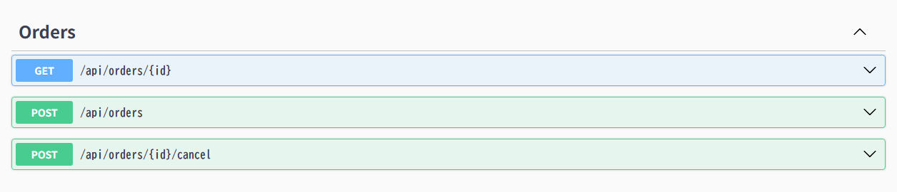
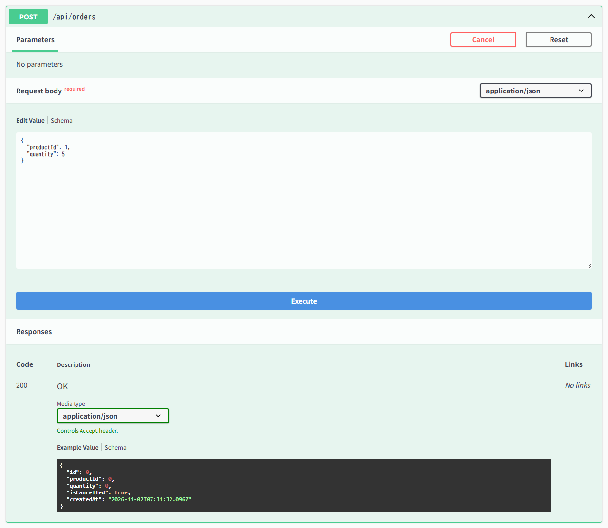
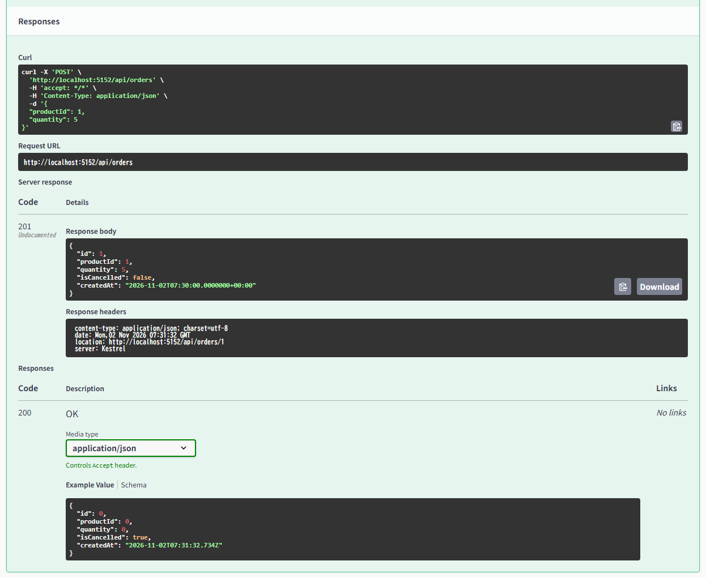
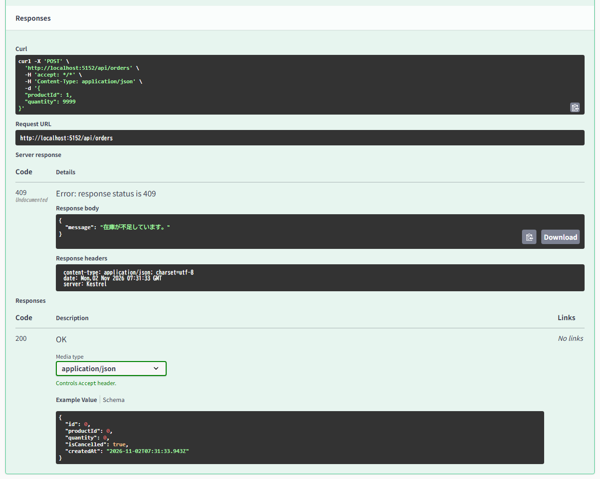
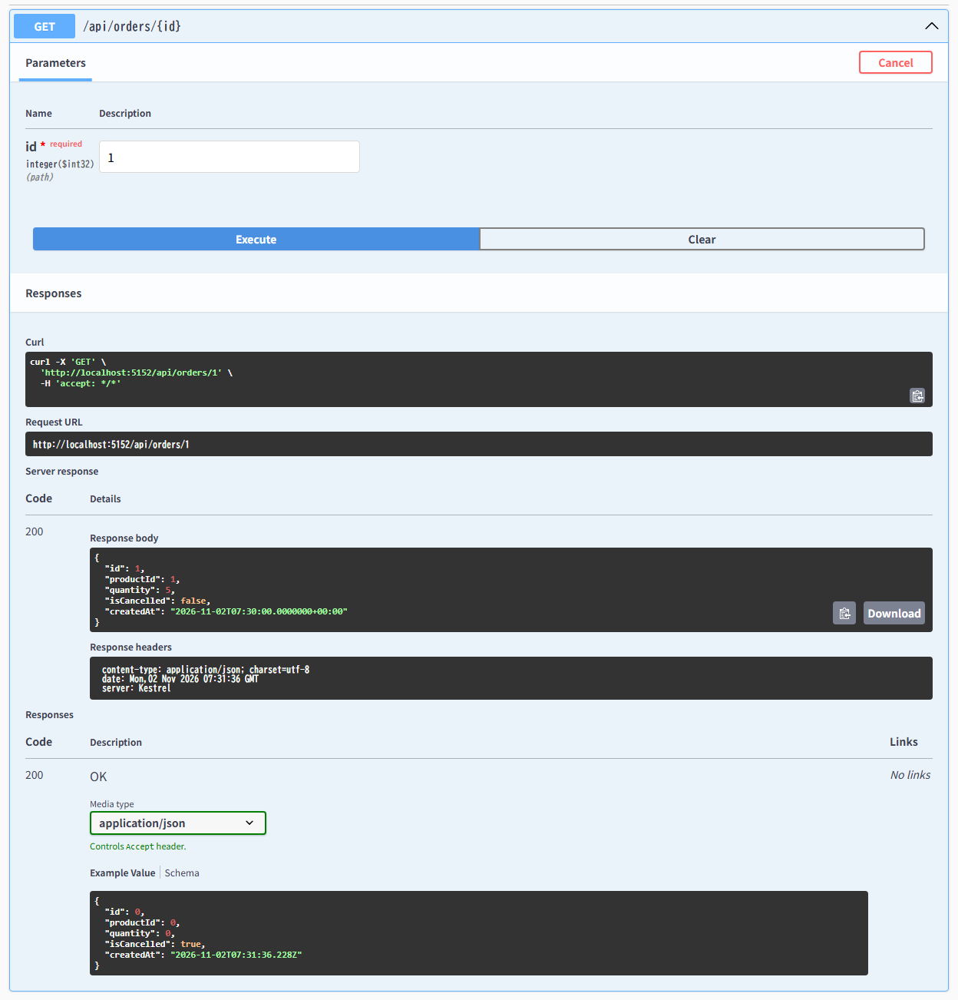
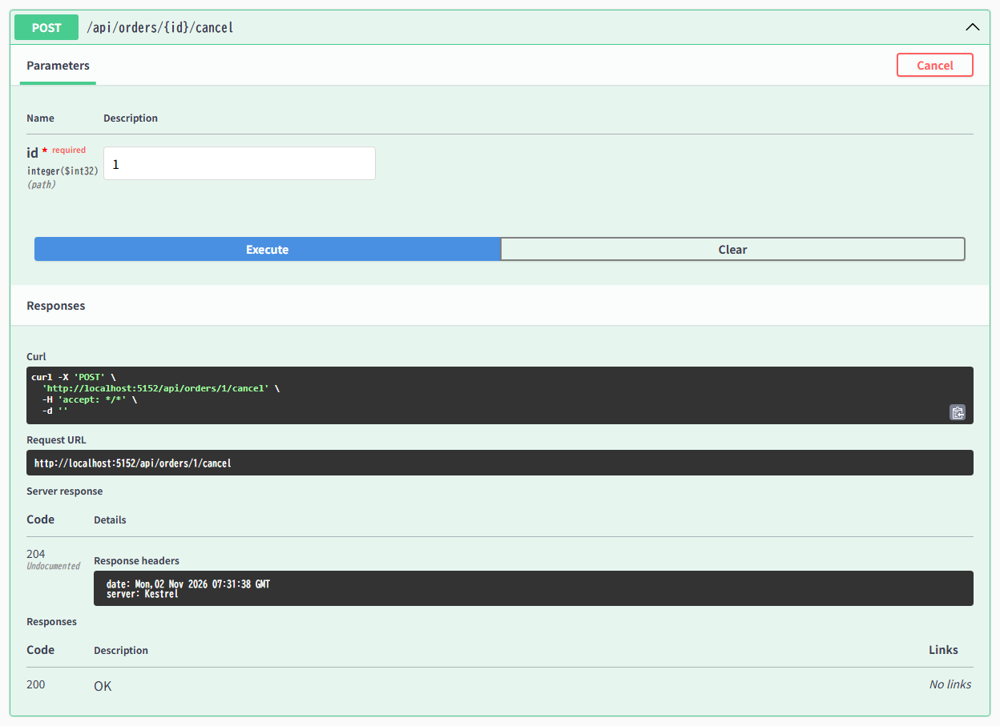
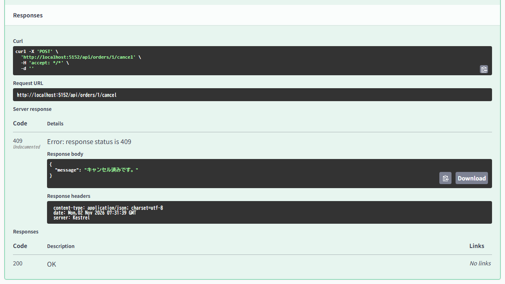

# Orders API 使い方ガイド（Swagger UI 操作手順書）

本ドキュメントでは、受注管理および在庫引当・復元を行う **Orders API (`/api/orders`)** の各エンドポイントの仕様と、Swagger UI（`http://localhost:5152/swagger/index.html`）を使った具体的な操作手順を画面キャプチャ付きで解説します。

---

## 1. Orders API 一覧

Swagger UI を開くと、**Orders** セクションに以下の3つのエンドポイントが表示されます。



| HTTP メソッド | エンドポイント | 機能概要 | 主なレスポンスコード |
| :--- | :--- | :--- | :--- |
| `GET` | `/api/orders/{id}` | 受注 ID を指定して1件の受注情報を取得する | `200 OK` / `404 Not Found` |
| `POST` | `/api/orders` | 受注を新規登録し、対象商品の在庫数を減算（引当）する | `201 Created` / `404 Not Found` / `409 Conflict` |
| `POST` | `/api/orders/{id}/cancel` | 受注をキャンセル状態にし、対象商品の在庫数を復元する | `204 No Content` / `404 Not Found` / `409 Conflict` |

---

## 2. 受注の新規登録と在庫引当 (`POST /api/orders`)

注文対象の商品 ID（`productId`）と受注数量（`quantity`）を指定して受注を登録します。
この API を実行すると、**トランザクション内で商品の在庫数（`StockQuantity`）が受注数量分だけ減算**され、同時に受注レコードが作成されます。

### 入力制約（バリデーション）
| フィールド名 | 型 | 必須 | 制約 | 備考 |
| :--- | :--- | :--- | :--- | :--- |
| `productId` | `int` | 必須 | `1` 以上 (`[Range(1, int.MaxValue)]`) | 存在する商品の ID を指定します |
| `quantity` | `int` | 必須 | `1` 以上 (`[Range(1, int.MaxValue)]`) | 受注する数量を指定します |

### 操作手順（リクエスト入力）
1. **`POST /api/orders`** の行をクリックして展開します。
2. 右上の **「Try it out」** ボタンをクリックすると、`Request body` のテキストエリアが編集可能になります。
3. 注文したい `productId` と `quantity` を JSON で入力し、**「Execute」** ボタンをクリックします。

```json
{
  "productId": 1,
  "quantity": 5
}
```



### 操作手順（正常時の実行結果：`201 Created`）
対象商品が存在し、かつ在庫が足りている場合は以下のレスポンスが返ります。
- **Code**: `201`（Created）
- **Response body**: 採番された受注 `id`、`productId`、`quantity`、`isCancelled`（`false`）、`createdAt`（UTC の受注日時）を含む JSON が返ります。
- **Response headers**: `location` ヘッダーに、作成された受注の取得用 URL（例: `http://localhost:5152/api/orders/1`）が含まれます。
- この時点で `GET /api/products/1` を確認すると、商品の `stockQuantity` が `5` 減算されています。



### 在庫不足・商品未存在時のエラーレスポンス（`409 Conflict` / `404 Not Found`）
商品の現在庫数を超える `quantity`（例: `9999`）を指定して実行した場合、データベース上の在庫は一切減算されず、ロールバックされた上でステータスコード **`409 Conflict`** が返ります。



- **`409 Conflict`**: 在庫数が受注数量に満たない場合（`{"message": "在庫が不足しています。"}`）
- **`404 Not Found`**: 指定した `productId` の商品が存在しない場合（`{"message": "商品が存在しません。"}`）

---

## 3. 受注 ID 指定での取得 (`GET /api/orders/{id}`)

特定の受注 ID（`id`）を指定して、受注内容やキャンセル状態（`isCancelled`）を確認します。

### 操作手順
1. **`GET /api/orders/{id}`** の行をクリックして展開します。
2. 右上の **「Try it out」** ボタンをクリックします。
3. **Parameters** の `id * required` 入力欄に確認したい受注 ID（例: `1`）を入力します。
4. **「Execute」** ボタンをクリックします。



### ステータスコード
- **`200 OK`**: 指定した ID の受注が存在する場合、受注情報の JSON（`id`, `productId`, `quantity`, `isCancelled`, `createdAt`）が返ります。
- **`404 Not Found`**: 指定した ID の受注が存在しない場合に返ります。

---

## 4. 受注のキャンセルと在庫復元 (`POST /api/orders/{id}/cancel`)

登録済みの受注をキャンセルします。
この API を実行すると、**トランザクション内で受注の `IsCancelled` フラグが `true` に更新され、同時に引当済みだった数量（`Quantity`）が対象商品の在庫（`StockQuantity`）へ加算（復元）**されます。

### 操作手順（正常時の実行：`204 No Content`）
1. **`POST /api/orders/{id}/cancel`** の行をクリックして展開します。
2. 右上の **「Try it out」** ボタンをクリックします。
3. **Parameters** の `id * required` 欄にキャンセルしたい受注 ID（例: `1`）を入力します（リクエストボディは不要です）。
4. **「Execute」** ボタンをクリックします。
5. キャンセルに成功すると、**Code `204`（No Content）** が返ります。



> [!TIP]
> キャンセル実行後に `GET /api/orders/1` を実行すると `isCancelled: true` に変わっていることが確認でき、`GET /api/products/1` を実行すると商品の在庫数（`stockQuantity`）が元の数に戻っていることが確認できます。

### 二重キャンセル防止のエラーレスポンス（`409 Conflict`）
すでにキャンセル済みの受注 ID に対して再度 `POST /api/orders/{id}/cancel` を実行した場合、ステータスコード **`409 Conflict`**（`{"message": "キャンセル済みです。"}`）が返り、在庫が二重に加算されるのを防ぎます。



### ステータスコードまとめ
- **`204 No Content`**: キャンセルおよび在庫復元に成功した場合に返ります。
- **`404 Not Found`**: 指定した `id` の受注が存在しない場合に返ります。
- **`409 Conflict`**: 対象受注がすでにキャンセル済みの場合に返ります（`{"message": "キャンセル済みです。"}`）。

---

## 5. 関連ドキュメント
- [プログラム概要 (Overview.md)](./Overview.md)
- [起動・環境構築手順書 (SetupGuide.md)](./SetupGuide.md)
- [Products API 使い方ガイド (ProductsGuide.md)](./ProductsGuide.md)

