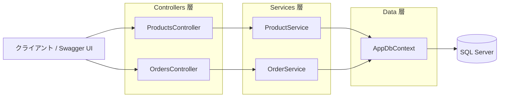
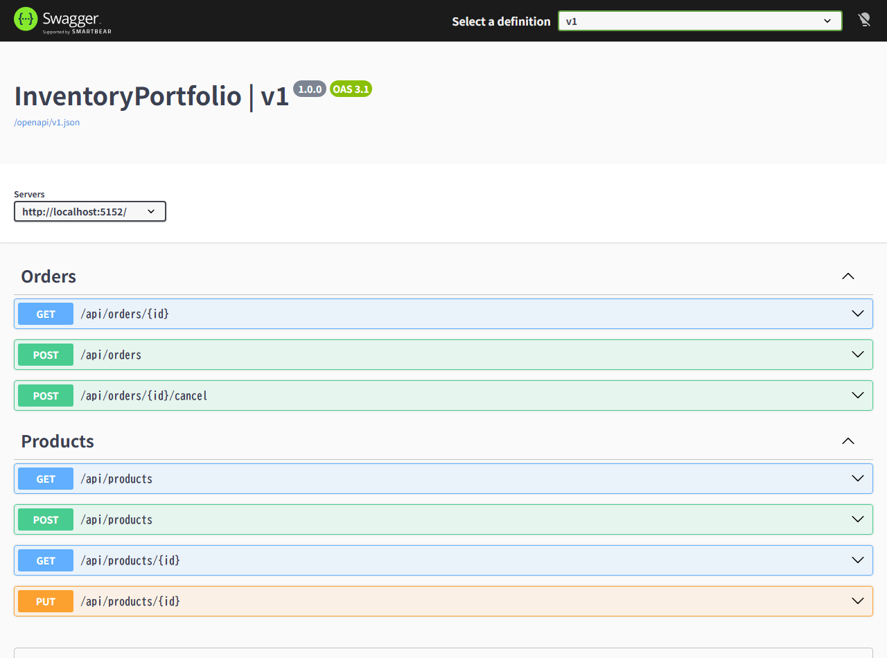

# InventoryPortfolio プログラム概要

## 1. はじめに
**InventoryPortfolio** は、ASP.NET Core (.NET 10.0) と Entity Framework Core (SQL Server) を用いて構築された、**商品在庫および受注管理を行う RESTful Web API** です。
商品の登録・参照・更新に加え、トランザクションとアトミックなクエリ更新（`ExecuteUpdateAsync`）を活用し、同時実行時にも在庫の不整合（マイナス在庫や二重キャンセル）が発生しない安全な受注・キャンセル処理を実現しています。

---

## 2. 使用技術・フレームワーク
| カテゴリ | 技術 / パッケージ | バージョン | 用途 |
| :--- | :--- | :--- | :--- |
| フレームワーク | .NET / ASP.NET Core Web API | `net10.0` | Web API 基盤 |
| ORM | Microsoft.EntityFrameworkCore.SqlServer | `10.0.14` | SQL Server データアクセス・マイグレーション |
| API ドキュメント | Microsoft.AspNetCore.OpenApi / Swashbuckle.AspNetCore.SwaggerUI | `10.0.14` / `10.3.1` | OpenAPI (v1) 生成および Swagger UI 表示 |

---

## 3. ディレクトリ・ファイル構成

```text
InventoryPortfolio/
├── Controllers/
│   ├── ProductsController.cs       # 商品管理 API エンドポイント
│   └── OrdersController .cs        # 受注管理 API エンドポイント
├── Data/
│   └── AppDbContext .cs            # EF Core DbContext・テーブル定義・制約設定
├── Dtos/
│   ├── ProductDto.cs               # 商品レスポンス DTO
│   ├── CreateProductRequest.cs     # 商品登録リクエスト DTO
│   ├── UpdateProductRequest.cs     # 商品名更新リクエスト DTO
│   ├── OrderDto.cs                 # 受注レスポンス DTO
│   └── CreateOrderRequest.cs       # 受注登録リクエスト DTO
├── Models/
│   ├── Product.cs                  # 商品エンティティ
│   └── Order.cs                    # 受注エンティティ
├── Services/
│   ├── IProactService.cs           # 商品サービス インターフェース (IProductService)
│   ├── ProactService.cs            # 商品ビジネスロジック (ProductService)
│   ├── IOrderService.cs            # 受注サービス インターフェース
│   ├── OrderService .cs            # 受注ビジネスロジック（在庫引当・キャンセル処理）
│   ├── CreateOrderResult.cs        # 受注登録結果レコード
│   └── OrderError.cs               # 受注処理エラー種別 Enum
├── Migrations/                     # EF Core マイグレーションファイル群
└── Program.cs                      # DI 登録・ミドルウェア・エントリポイント設定
```

---

## 4. アーキテクチャと処理フロー

コントローラー層・サービス層・データアクセス層（EF Core）の3層構造を採用しています。



---

## 5. データベース設計

[`AppDbContext`](../Data/AppDbContext%20.cs) にて以下の2テーブルと整合性制約が定義されています。

### 5.1 `Products`（商品テーブル）
| カラム名 | 型 | 制約 | 説明 |
| :--- | :--- | :--- | :--- |
| `Id` | `int` | PK, Identity | 商品ID |
| `Name` | `nvarchar(100)` | Required, MaxLength(100) | 商品名 |
| `StockQuantity` | `int` | Required, `CK_Products_StockQuantity` (`>= 0`) | 在庫数量 |

### 5.2 `Orders`（受注テーブル）
| カラム名 | 型 | 制約 | 説明 |
| :--- | :--- | :--- | :--- |
| `Id` | `int` | PK, Identity | 受注ID |
| `ProductId` | `int` | FK (`Products.Id`), `DeleteBehavior.Restrict` | 注文対象の商品ID |
| `Quantity` | `int` | Required, `CK_Orders_Quantity` (`> 0`) | 受注数量 |
| `IsCancelled` | `bit` | Required, Default(`false`) | キャンセル済みフラグ |
| `CreatedAt` | `datetimeoffset` | Required | 受注日時（UTC） |

---

## 6. API エンドポイント一覧



### 6.1 商品 API (`api/products`)
| HTTP メソッド | エンドポイント | 概要 | リクエスト Body | ステータスコード |
| :--- | :--- | :--- | :--- | :--- |
| `GET` | `/api/products` | 商品一覧の取得（ID昇順） | なし | `200 OK` |
| `GET` | `/api/products/{id}` | 指定IDの商品取得 | なし | `200 OK` / `404 Not Found` |
| `POST` | `/api/products` | 商品の新規登録 | `CreateProductRequest` (`Name`, `StockQuantity`) | `201 Created` / `400 Bad Request` |
| `PUT` | `/api/products/{id}` | 商品名の変更 | `UpdateProductRequest` (`Name`) | `204 No Content` / `404 Not Found` |

### 6.2 受注 API (`api/orders`)
| HTTP メソッド | エンドポイント | 概要 | リクエスト Body | ステータスコード |
| :--- | :--- | :--- | :--- | :--- |
| `GET` | `/api/orders/{id}` | 指定IDの受注情報取得 | なし | `200 OK` / `404 Not Found` |
| `POST` | `/api/orders` | 受注登録および在庫引当 | `CreateOrderRequest` (`ProductId`, `Quantity`) | `201 Created` / `404 Not Found`（商品なし） / `409 Conflict`（在庫不足） |
| `POST` | `/api/orders/{id}/cancel` | 受注キャンセルおよび在庫復元 | なし | `204 No Content` / `404 Not Found`（受注なし） / `409 Conflict`（キャンセル済み） |

---

## 7. 主要な設計上の特徴（同時実行制御と整合性担保）

1. **条件付き一括更新（`ExecuteUpdateAsync`）による在庫引当**
   - 受注登録時（[`OrderService.CreateAsync`](../Services/OrderService%20.cs)）に、`Id == ProductId && StockQuantity >= Quantity` を条件としてデータベース上で直接在庫を減算します。
   - 更新件数が `0` 件だった場合はトランザクションをロールバックし、商品の存在確認を行って「商品未存在 (`ProductNotFound`)」と「在庫不足 (`InsufficientStock`)」を正確に判別します。
2. **二重キャンセルの防止**
   - 受注キャンセル時（[`OrderService.CancelAsync`](../Services/OrderService%20.cs)）に、`Id == id && !IsCancelled` を条件に `ExecuteUpdateAsync` を実行することで、同時リクエストによる二重キャンセルと在庫の二重加算を防止しています。
3. **DB レベルの CHECK 制約と外部キー制約**
   - アプリケーション層だけでなく DB 側にも `StockQuantity >= 0` および `Quantity > 0` の CHECK 制約、ならびに注文が存在する商品の削除を禁止する `DeleteBehavior.Restrict` を設定し、データの堅牢性を高めています。
4. **読み取り専用クエリの最適化**
   - 参照系メソッド（`GetAllAsync`, `GetByIdAsync`）では `AsNoTracking()` を使用し、EF Core の変更追跡オーバーヘッドを削減しています。

---

## 8. 関連ドキュメント
- [起動・環境構築手順書 (SetupGuide.md)](./SetupGuide.md) — DB 作成・マイグレーション適用・アプリケーションの起動方法
- [Products API 使い方ガイド (ProductsGuide.md)](./ProductsGuide.md) — Swagger UI での商品 API 操作手順（画面キャプチャ付き）
- [Orders API 使い方ガイド (OrdersGuide.md)](./OrdersGuide.md) — Swagger UI での受注・キャンセル API 操作手順（画面キャプチャ付き）


