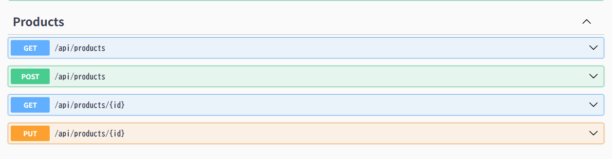
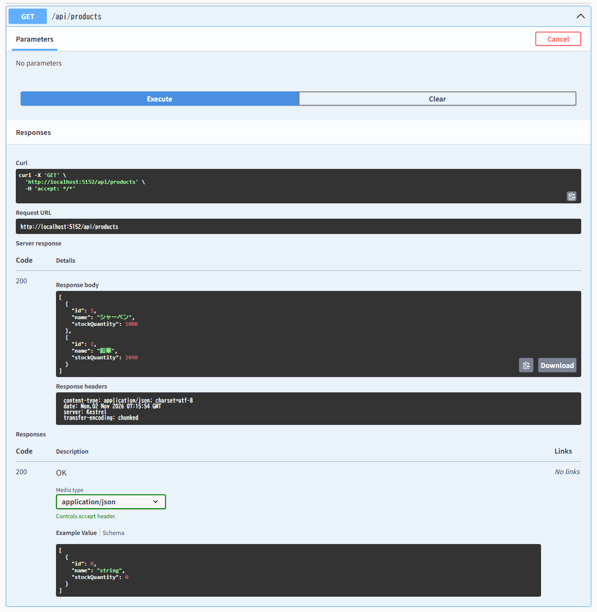
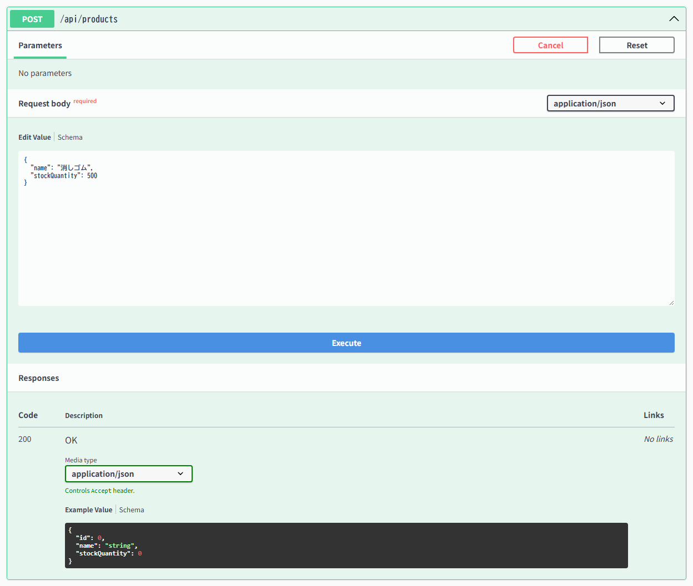
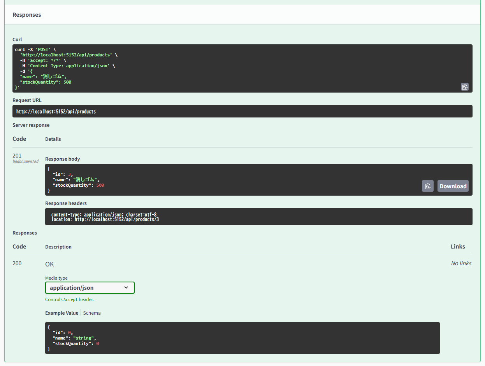
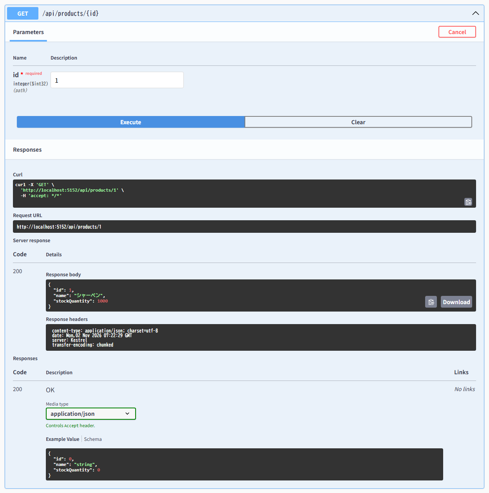
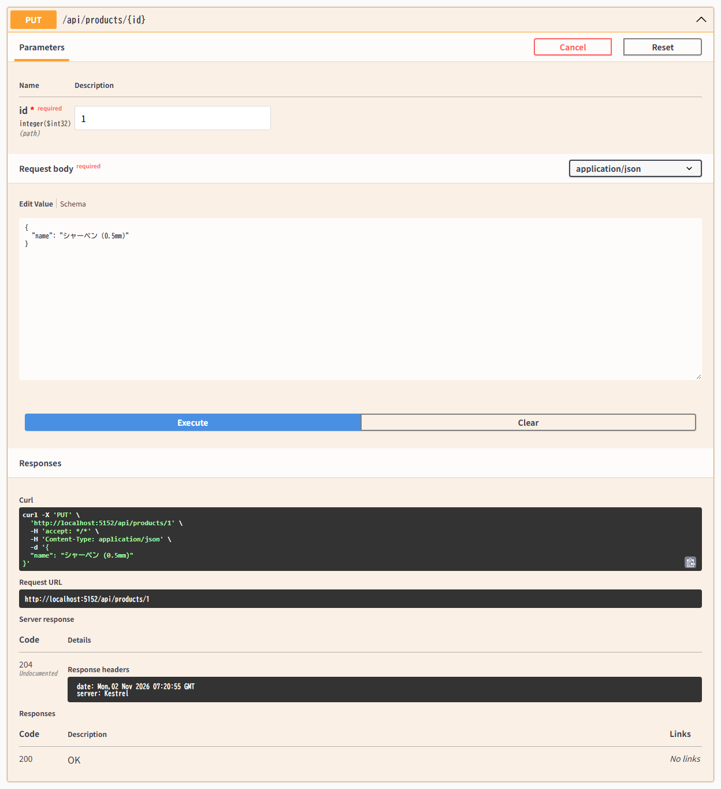

# Products API 使い方ガイド（Swagger UI 操作手順書）

本ドキュメントでは、商品管理を行う **Products API (`/api/products`)** の各エンドポイントの仕様と、Swagger UI（`http://localhost:5152/swagger/index.html`）を使った具体的な操作手順を画面キャプチャ付きで解説します。

---

## 1. Products API 一覧

Swagger UI を開くと、**Products** セクションに以下の4つのエンドポイントが表示されます。



| HTTP メソッド | エンドポイント | 機能概要 | 主なレスポンスコード |
| :--- | :--- | :--- | :--- |
| `GET` | `/api/products` | 登録されている全商品を ID 昇順で一覧取得する | `200 OK` |
| `POST` | `/api/products` | 新しい商品と初期在庫数を登録する | `201 Created` / `400 Bad Request` |
| `GET` | `/api/products/{id}` | 商品 ID を指定して1件の商品情報を取得する | `200 OK` / `404 Not Found` |
| `PUT` | `/api/products/{id}` | 指定した商品 ID の商品名を更新する | `204 No Content` / `404 Not Found` |

---

## 2. 商品一覧の取得 (`GET /api/products`)

現在データベースに登録されているすべての商品（ID・商品名・在庫数）を一覧で取得します。パラメーターは不要です。

### 操作手順
1. **`GET /api/products`** の行をクリックして展開します。
2. 右上の **「Try it out」** ボタンをクリックします。
3. 青い **「Execute」** ボタンをクリックします。
4. 下部の **Server response** にステータスコード `200` と商品一覧の JSON 配列が表示されます。



### レスポンス例 (`200 OK`)
```json
[
  {
    "id": 1,
    "name": "シャーペン",
    "stockQuantity": 1000
  },
  {
    "id": 2,
    "name": "鉛筆",
    "stockQuantity": 2040
  }
]
```

---

## 3. 商品の新規登録 (`POST /api/products`)

新しい商品をデータベースに登録します。リクエストボディには商品名（`name`）と初期在庫数（`stockQuantity`）を JSON 形式で指定します。

### 入力制約（バリデーション）
| フィールド名 | 型 | 必須 | 制約 | 備考 |
| :--- | :--- | :--- | :--- | :--- |
| `name` | `string` | 必須 (`[Required]`) | 1〜100文字 (`[StringLength(100)]`) | 前後の空白は登録時に自動トリム（`Trim()`）されます |
| `stockQuantity` | `int` | 必須 | `0` 以上 (`[Range(0, int.MaxValue)]`) | マイナス値は指定できません |

### 操作手順（リクエスト入力）
1. **`POST /api/products`** の行をクリックして展開します。
2. 右上の **「Try it out」** ボタンをクリックすると、`Request body` のテキストエリアが編集可能になります。
3. 登録したい商品の JSON を入力し、**「Execute」** ボタンをクリックします。

```json
{
  "name": "消しゴム",
  "stockQuantity": 500
}
```



### 操作手順（実行結果の確認）
**「Execute」** を押すと、下に **Responses** が表示されます。
- **Code**: `201`（Created）が返ります。
- **Response body**: 採番された `id` を含む登録済み商品の JSON が返ります。
- **Response headers**: `location` ヘッダーに、作成された商品の取得用 URL（例: `http://localhost:5152/api/products/3`）が含まれます。



---

## 4. 商品 ID 指定での取得 (`GET /api/products/{id}`)

特定の商品 ID（`id`）を指定して、1件の商品情報を取得します。

### 操作手順
1. **`GET /api/products/{id}`** の行をクリックして展開します。
2. 右上の **「Try it out」** ボタンをクリックします。
3. **Parameters** の `id * required` 入力欄に取得したい商品の ID（例: `1`）を入力します。
4. **「Execute」** ボタンをクリックします。



### ステータスコード
- **`200 OK`**: 指定した ID の商品が存在する場合、商品情報の JSON（`id`, `name`, `stockQuantity`）が返ります。
- **`404 Not Found`**: 指定した ID の商品が存在しない場合に返ります。

---

## 5. 商品名の変更 (`PUT /api/products/{id}`)

登録済み商品の**商品名（`name`）**を変更します。

> [!NOTE]
> 在庫数（`stockQuantity`）の増減は受注 API（`POST /api/orders` および `POST /api/orders/{id}/cancel`）を通じてトランザクション制御下で行われる設計のため、`PUT /api/products/{id}` では商品名のみを更新対象としています（[`UpdateProductRequest`](../Dtos/UpdateProductRequest.cs)）。

### 操作手順
1. **`PUT /api/products/{id}`** の行をクリックして展開します。
2. 右上の **「Try it out」** ボタンをクリックします。
3. **Parameters** の `id * required` 欄に更新対象の商品 ID（例: `1`）を入力します。
4. **Request body** に新しい商品名（`name`）を JSON で入力します。
   ```json
   {
     "name": "シャーペン (0.5mm)"
   }
   ```
5. **「Execute」** ボタンをクリックします。



### ステータスコード
- **`204 No Content`**: 更新に成功した場合に返ります（レスポンスボディはありません）。更新後に `GET /api/products/{id}` を実行すると、商品名が変更されていることを確認できます。
- **`404 Not Found`**: 指定した `id` の商品が存在しない場合に返ります。
- **`400 Bad Request`**: `name` が空文字または100文字を超えている場合に返ります。

---

## 6. 関連ドキュメント
- [プログラム概要 (Overview.md)](./Overview.md)
- [起動・環境構築手順書 (SetupGuide.md)](./SetupGuide.md)
- [Orders API 使い方ガイド (OrdersGuide.md)](./OrdersGuide.md)

