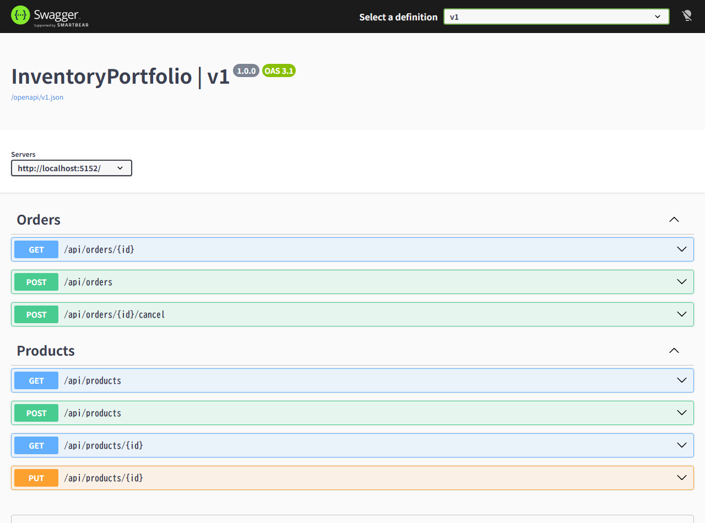

# InventoryPortfolio 起動・環境構築手順書

本ドキュメントでは、`InventoryPortfolio` をローカル環境でセットアップし、データベース作成・マイグレーション適用からアプリケーションの起動・動作確認までを行う手順を説明します。

---

## 1. 前提条件（必要な環境）

- **.NET 10.0 SDK** がインストールされていること
- **SQL Server**（Developer / Express / LocalDB / Docker 等）が稼働していること
- （任意）**Visual Studio 2022 / 2026** または **SQL Server Management Studio (SSMS)**

---

## 2. データベースの準備と接続文字列の設定

### 2.1 デフォルトの接続設定
[`appsettings.json`](../appsettings.json) には以下の接続文字列（`DefaultConnection`）が設定されています。

```json
"ConnectionStrings": {
  "DefaultConnection": "Server=localhost;Database=InventoryPortfolioDb;User Id=portfolio;Password=portfolio1;Encrypt=True;TrustServerCertificate=True;"
}
```

### 2.2 SQL Server 側の準備（SQL Server 認証を使用する場合）
デフォルトの接続文字列をそのまま使う場合は、SQL Server（SSMS や `sqlcmd`）でログインアカウントを作成し、データベース作成権限（`dbcreator` など）または対象データベースの権限を付与してください。

```sql
-- 1. ログインの作成（未作成の場合）
CREATE LOGIN [portfolio] WITH PASSWORD = N'portfolio1', CHECK_POLICY = OFF;
GO

-- 2. マイグレーションでDBを自動作成できるように dbcreator ロールを付与（または事前にDBを作成）
ALTER SERVER ROLE [dbcreator] ADD MEMBER [portfolio];
GO
```

> [!TIP]
> **事前に空のデータベースを手動作成する場合**
> `dbcreator` 権限を付与せず、管理者が先に DB を作成する場合は以下の SQL を実行してください。
> ```sql
> CREATE DATABASE [InventoryPortfolioDb];
> GO
> USE [InventoryPortfolioDb];
> GO
> CREATE USER [portfolio] FOR LOGIN [portfolio];
> ALTER ROLE [db_owner] ADD MEMBER [portfolio];
> GO
> ```

> [!NOTE]
> **Windows 認証（統合認証）や LocalDB を使用する場合**
> 環境に合わせて [`appsettings.json`](../appsettings.json) の `DefaultConnection` を書き換えることも可能です。
> - **Windows 認証**:
>   `Server=localhost;Database=InventoryPortfolioDb;Trusted_Connection=True;TrustServerCertificate=True;`
> - **LocalDB**:
>   `Server=(localdb)\\mssqllocaldb;Database=InventoryPortfolioDb;Trusted_Connection=True;`

---

## 3. DB 作成とマイグレーションの適用

本プロジェクトには EF Core のマイグレーションファイル（`Migrations/` フォルダ）およびローカルツール設定（[`dotnet-tools.json`](../dotnet-tools.json)）が含まれています。
マイグレーションを実行すると、**データベース（`InventoryPortfolioDb`）が未作成の場合は自動的に作成され**、`Products` テーブルと `Orders` テーブルが構築されます。

### 方法 A: コマンドライン（CLI）で実行する場合

プロジェクトのルートディレクトリ（`D:\VS_Project\InventoryPortfolio`）でターミナル（PowerShell 等）を開き、以下のコマンドを順に実行します。

```powershell
# 1. ローカルツール（dotnet-ef）の復元
dotnet tool restore

# 2. データベースの作成とマイグレーションの適用
dotnet ef database update
```

### 方法 B: Visual Studio（パッケージ マネージャー コンソール）で実行する場合

1. Visual Studio で `InventoryPortfolio.slnx` を開きます。
2. メニューから **[ツール]** > **[NuGet パッケージ マネージャー]** > **[パッケージ マネージャー コンソール]** を開きます。
3. 以下のコマンドを実行します。

```powershell
Update-Database
```

### （参考）モデル変更時に新しくマイグレーションを作成する場合
エンティティや [`AppDbContext`](../Data/AppDbContext%20.cs) を変更した場合は、以下のコマンドでマイグレーションを追加・適用します。

```powershell
# CLI の場合
dotnet ef migrations add <MigrationName>
dotnet ef database update

# パッケージ マネージャー コンソールの場合
Add-Migration <MigrationName>
Update-Database
```

---

## 4. アプリケーションの起動手順

### 方法 A: コマンドライン（CLI）から起動
プロジェクトルートで以下のコマンドを実行します。

```powershell
dotnet run
```

起動すると、`http://localhost:5152` で Web API がリッスン状態になります。

### 方法 B: Visual Studio から起動
1. Visual Studio 上部の起動プロファイルが **`http`** になっていることを確認します。
2. **`F5` キー**（デバッグ開始）または **`Ctrl + F5` キー**（デバッグなしで開始）を押します。
3. [`Properties/launchSettings.json`](../Properties/launchSettings.json) の設定に従い、ブラウザが自動で起動して Swagger UI が開きます。

---

## 5. 動作確認（Swagger UI / API テスト）

### 5.1 Swagger UI での確認
開発環境（`Development`）で起動後、ブラウザで以下の URL にアクセスします。

- **Swagger UI**: http://localhost:5152/swagger/index.html
- **OpenAPI JSON**: http://localhost:5152/openapi/v1.json



### 5.2 一連の動作確認シナリオ（サンプル）

Swagger UI または `curl` / REST Client で以下の順番にリクエストを送ることで、在庫引当・キャンセル動作を確認できます。

#### ① 商品を登録する (`POST /api/products`)
```json
{
  "name": "ノートパソコン",
  "stockQuantity": 10
}
```
→ `201 Created` が返り、`id: 1`, `stockQuantity: 10` の商品が作成されます。

#### ② 受注を登録する (`POST /api/orders`)
```json
{
  "productId": 1,
  "quantity": 3
}
```
→ `201 Created` が返り、受注が作成されます。
この時点で `GET /api/products/1` を実行すると、`stockQuantity` が **`7`** に減っていることが確認できます。

#### ③ 受注をキャンセルする (`POST /api/orders/1/cancel`)
- リクエストボディなしで `POST /api/orders/1/cancel` を実行します。
→ `204 No Content` が返ります。
- 再度 `GET /api/products/1` を実行すると、`stockQuantity` が **`10`** に戻っていることが確認できます。
- 同じ受注に対してもう一度 `POST /api/orders/1/cancel` を実行すると、`409 Conflict`（`{"message": "キャンセル済みです。"}`）が返ります。

